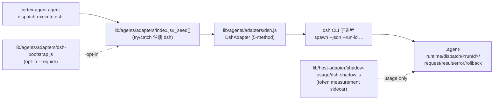

# DSH (DeepSeek Harness) First-Class Adapter — 架构决策

> **状态**: 已实施（M-029，2026-08-19）
> **决策**: `D-ARI-P006-promote-dsh-firstclass`（user approved）
> **实施载体**: Mission M-029（MS-001～MS-004 PASS，MS-005 waived）
> **集成指南**: [docs/host-dsh-integration.md](../host-dsh-integration.md)

## 1. 背景与问题

Cortex Agent 的 first-class dispatch adapter 体系（`lib/agents/adapters/`，五方法契约 `discover / health / invoke / cancel / report`）原本覆盖 Pi、Claude Code、Codex CLI、MiniMax。DeepSeek Harness (DSH) 此前仅是 **Token Control Plane 的第三 governed shadow host**（决策 `D-TCP-004`，只做 usage measurement）：

- `lib/host-adapter/shadow-usage/dsh-shadow.js` — 从 DSH session envelope 提取 token 用量写 ledger；
- `scripts/dsh-usage-sync.js` — backfill `~/.dsh/sessions/` 的 usage 事件（832 receipts 已回放验证）。

**缺口**：DSH 没有 dispatch adapter，`cortex-agent agent dispatch-execute dsh:<id>` 无目标；没有 `templates/integrations/dsh/`（`cortex-agent add dsh` 无模板）；没有 `docs/host-dsh-integration.md`；agent 注册 `external.adapter_type = "dsh"` 会抛 `ERR_INVALID_ADAPTER_TYPE`。DSH 与 Pi / Claude Code / Codex CLI 在"可被 Cortex 治理地执行"这一维度上不对等。

## 2. 最终决策

批准把 DSH 从 shadow usage host **提升为与 Pi / Claude Code / Codex CLI 同等地位的 first-class dispatch adapter**：

1. 新增 `lib/agents/adapters/dsh.js`（~650 行，`DshAdapter extends BaseAdapter`，五方法契约 + 6 类失败模式）。
2. 注册路径走 **additive 扩展**：`VALID_ADAPTER_TYPES_EXT` 加入 `"dsh"`、`_seed()` try/catch 注入、`dsh-bootstrap.js`（opt-in）、`adapter-core.js` 加入 `dsh.local` / `dsh.dev`；**不修改** M-002 frozen 的 `lib/agents/registry.js`。
3. 双语模板 `templates/{zh,en}/integrations/dsh/{README.md, AGENTS.md, settings.json}` + `cortex-agent add dsh` CLI。
4. `docs/host-dsh-integration.md`（安装 / 注册 / dispatch / 限制四节）。
5. 能力声明遵守 P-001 冻结词汇：`tool.before.*` / `context.render.observe` 显式 `unsupported`（无真实 hook 证据前不假装支持）。

**批准范围**（`D-ARI-P006` rationale）：不包含 DSH 自动 dispatch 默认启用、未经门禁的外部副作用、Provider/Agent Loop/TUI 自建、复制 DSH 完整 session JSONL storage。

## 3. 方案对比摘要

| 维度 | 维持现状（DSH 仅 shadow） | 复制 Pi 完整链路（不推荐） | 本决策（P-006） |
| :--- | :--- | :--- | :--- |
| 架构合规 | DSH 只在 measurement 层 governed | 与 M-003 / P-001 冲突 | 沿用既有五方法契约与 `_seed()` try/catch 模式 |
| 跨 host 对等 | DSH 与 Codex/Pi 不可比 | 高度重复，回归负担重 | DSH 进入既有 first-class 体系 |
| token 治理一致性 | DSH 已在 TCP 中（D-TCP-004） | 复制 token 抓取易双源真相 | 复用 `dsh-shadow.js`，single source of truth |
| 模板与 CLI 对称 | `cortex-agent add dsh` 无模板 | 不解决模板层 | 与 claude / codex / pi / minimax 对齐 |
| 实施成本 | 0 | 高 | 中（1 adapter + 1 bootstrap + 模板 + 文档 + 测试） |
| 迁移风险 | DSH 用户手工拼装 | 大 | additive、缺省关闭、可回退 |

## 4. 架构与调用流

**关键流程**：

1. `invoke()` 写 `request.json` → spawn `dsh --profile headless [--json] -- -`（任务经 stdin 投递）→ 解析 NDJSON 运行事件 → 以 `{"type":"final"}` 为结算信号 → 写 `result.json` + `rollback.json`（atomic `.tmp + rename`）。**注**：P-006 原始文档设想的 `--json --run-id --task` + JSON-RPC 形状在 M-034 WP-03（2026-11-07）被证伪并替换，见 §8。
2. 失败模式全部写 `error.json` + `rollback.json`（或 `rollback-failed.json` + `notify_parent: true`）：`ERR_ADAPTER_SPAWN` / `ERR_DSH_TRANSPORT_UNSUPPORTED` / `ERR_DSH_TASK_REQUIRED` / `ERR_DISPATCH_FAILED` / `ERR_DISPATCH_TIMEOUT` / `ERR_DSH_EVENT_PARSE` / `ERR_DSH_<code>` / rollback 写失败。
3. `cancel()` 通过 `_subprocesses` Map（runId → child）SIGTERM；`report()` 读 journal 并附加 `adapter_type` + `latency_ms`。

**能力声明**（`discover().capability_descriptor`，P-001 冻结词汇）：

| 能力 | 等级 | 来源 |
| :--- | :--- | :--- |
| session.boundary | explicit | self-reported |
| turn.boundary | adapter | runtime-trace |
| message.boundary | unobservable | not-exposed |
| tool.before.observe / block | unsupported | not-implemented |
| tool.update | unobservable | not-exposed |
| context.render.observe | unsupported | not-implemented |

## 5. 影响范围

- **新增**：`lib/agents/adapters/dsh.js`、`lib/agents/adapters/dsh-bootstrap.js`、`lib/agents/registry-ext.js`（M-034 WP-03 additive 读取器）、`templates/{zh,en}/integrations/dsh/`（6 文件）、`docs/host-dsh-integration.md`、`tests/agent/agent-adapter-dsh.test.js`、`tests/cli/add-host-dsh.test.js`。
- **修改（additive）**：`lib/agents/registry-adapter-types.js`（`VALID_ADAPTER_TYPES_EXT` 加 `"dsh"`）、`lib/agents/adapters/index.js#_seed()`（末尾 try/catch 注入）、`lib/coordination/adapter-core.js`（`REGISTERED_ADAPTER_IDS` 加 `dsh.local`/`dsh.dev`）、`lib/registry/index.js`（`PLATFORM_REGISTRY.dsh`）、`docs/platform-integration.md`（平台映射表行）、`docs/architecture/adapter-authoring.md`（§9.4 / §9.5）。
- **零修改（硬约束）**：`lib/agents/registry.js`（M-002 frozen）、`bin/cli.js`、既有 5 个 vendor adapter。
- **不触碰**：`~/.dsh/sessions/`（shadow backfill 独占）、`lib/host-adapter/shadow-usage/dsh-shadow.js`、TCP 测量逻辑。

## 6. 迁移与回滚策略

- **纯加法**：`cortex-agent upgrade` 不覆盖用户对本地治理目录的改动；`add dsh` 的 `settings.json` 走 merge（保留用户字段），README/AGENTS 已存在则跳过。
- **回滚**：移除 `_seed()` try/catch 块或从 `VALID_ADAPTER_TYPES_EXT` 删除 `"dsh"` 即恢复 pre-P-006 行为；其他宿主不受影响（注册为可选）。
- **fail-closed**：DSH CLI 未安装时 `health()` → `ready: false`；`invoke()` 在 `verifyTransport` 下先跑 probe，未 `ready` 时返回 `ERR_DSH_TRANSPORT_UNSUPPORTED` 并写结构化失败，不影响既有 dispatch。

## 7. 后续任务

- [ ] DSH 真实 hook 能力证据出现后，单列 P-007 follow-up（tool gate + context pilot），把 `tool.before.*` / `context.render.observe` 从 `unsupported` 提升。
- [x] `docs/architecture.md` 既有对 ARI 提案的本地治理目录路径引用已迁移为 docs 相对链接（commit `95052e8`）。
- [x] 完整 CLI e2e（`cortex-agent agent dispatch-execute dsh:<id>` 真实 agent 条目）已补：`tests/agent/agent-adapter-dsh.test.js` 覆盖 `dsh:` 前缀 + headless 派发全链路（fake binary）。

---

> 返回：[架构文档](./README.md) | [集成指南](../host-dsh-integration.md) | [Adapter Authoring](./adapter-authoring.md)

## 8. 2026-11-07 修复附录（M-034 WP-03）

对真实 `dsh 0.2.1-rc.5` 逐层实测后发现 P-006 的"派发可用"并未真正落地，三处断路已在本轮修复：

| 层 | 断点 | 修复 |
| :--- | :--- | :--- |
| 注册 | `registry.js#validateEntry` 用 M-002 冻结表拒收 `dsh`，`readAgent` 因此抛 `ERR_AGENT_PARSE`；`VALID_ADAPTER_TYPES_EXT` 只在 `m003-cli` 的 protocol 分支被调用，位于 `readAgent` 之后（死代码） | 新增 `lib/agents/registry-ext.js`：先跑冻结校验，仅对 `ERR_INVALID_ADAPTER_TYPE` 用 M-002 ∪ EXT 联合表重校验 adapter_type，其余字段仍走原校验；`discover` / `invoke` / `dispatch-execute` 改用它。`registry.js` 保持零修改 |
| 执行 | `invoke()` 仍 spawn `--json --run-id --task` + stdin JSON-RPC，真实 CLI 直接 `error: --profile <name> is required`（exit 1） | 改为 `--profile headless [--json] -- -`，任务走 stdin；解析 NDJSON（`session` / `status` / `thinking` / `text` / `tool_call` / `tool_result` / `final` / `error`），仅 `final` 视为结算，其余 exit 0 记 `blocked` |
| 探针 | `probe()` 用 `path.resolve(bin)` 解析裸命令 → `<cwd>/dsh` 必然 ENOENT；`health()` 只做 `which` 故 CLI 显示假阳性；probe 无 CLI 入口 | `_resolveBinary()` 按 PATH/PATHEXT 解析；`health({probe:true})` 叠加 probe 结果；新增 `agent adapter probe <id>`；CLI 派发前传 `verifyTransport: true` |

附带一致性修复：`discover()` 探测前不再宣称 `stdio-json-rpc` 可用（`transport_supported=[]`、`transport:null`、`maturity:"experimental"`）；`host-runtime-snapshots` 移除 dsh 两条过时 `missing_*` 限制并新增 `transport_unverified`；`agent discover --adapter-type dsh` 接受 EXT 联合表；`dsh:<id>` 前缀解析落地（前缀与条目 `adapter_type` 不一致时报 `ERR_ADAPTER_PREFIX_MISMATCH`）。

2026-11-07 复核补丁：`probe()` 不再只靠 `dsh --help` 文本里出现 "headless" 就宣称可用——它额外执行有界的 `dsh --profile headless --help`，profile 缺失/损坏时归类 `unsupported`（`headless_profile_*`），并把 `profile.exit_code` / `profile.ok` 写入 probe 结果与缓存；`invoke()` 默认 `shell:false`（任务只走 stdin，避免 `args + shell:true` 的 DEP0190 与注入面）。通知泵把 `dsh` 注册为显式 deferred adapter：0.2.1-rc.5 没有 session 注入/唤醒 API，投递以 `ERR_NOTIFICATION_ADAPTER_UNAVAILABLE` 失败关闭，不伪造送达。

2026-11-07 稳定性补丁（独立复核 FAIL 后）：profile 探针改为独立 15s 预算并超时重试一次（实测 profile 启动 3.1–4.6s，共享 5s 预算在并行负载下约 50% 误判 `unsupported`，进而让 `verifyTransport` 拒绝健康主机）；成功还要求 stdout 匹配 `Usage: dsh --profile headless`，防止包装器转发 launcher help；probe 缓存按结果分 TTL（ready 120s / 失败 15s），`discover()` 不再用过期缓存宣称 `ready`；真实 PATH 用例在 profile 不就绪时显式 skip；CLI human 输出在未 ready 时不再展示 `transport_supported=text-headless-v1`。注意：boot profile 会让 dsh 刷新自己的 `$DSH_HOME/profiles/headless/cordis.yml`（实测 mtime 变化），适配器本身不解析 dsh 配置。

## 9. 2026-11-09 会话连续性与多会话批调度

真实 headless 的一次运行就是一个 DSH 会话：运行流的第一个事件是
`{"type":"session","sessionId":"..."}`，把它交给下一次运行即续接同一段对话
（实测续接时 `turn` 递增）。本轮据此补齐两件事：

1. **会话连续性**：`lib/agents/adapters/dsh.js` 解析 `session` 事件并把 id 写进
   `result.session_id`（ok / blocked / failed 各分支都带；`timeout` 分支没有可观测的
   事件流，因此为 `null`）；`agent dispatch-execute` 新增 `--session-id <id>`，透传给
   适配器后变成 `dsh --profile headless --json --session-id <id> -`。该参数只有 `dsh`
   适配器会翻译，其他适配器忽略它并打印 stderr 警告。
2. **多会话批调度**：新增 `lib/agents/batch-dispatch.js` 与
   `agent dispatch-batch --tasks <file.json> [--concurrency N]`。它复用既有的
   per-adapter `invoke()` 路径（不自起进程、不重复状态机），每个任务拿到独立
   run_id、独立 journal、默认独立 DSH 会话；汇总写入 dispatch 目录下的
   `batch.json`（目录由 `base.js#dispatchDir` 决定），逐条如实统计
   `ok / blocked / timeout / failed`，并把**观测到的** `session_id` 与**请求续接的**
   `requested_session_id` 分开报告。

边界与取舍：

- **并发默认 1**（上限 16）。多个 worker 在同一工作树写文件会互相干扰，因此并行
  必须显式开启，且并行任务应各自使用 worktree。`--concurrency` 传入非法值直接
  退出 2，不会静默退回串行。
- **不伪造送达**：批次状态由各任务真实结果聚合而成，任一 `failed`/`timeout` 时整体
  `failed`，只有 `blocked` 时 `partial`，全绿才是 `ok`；退出码 0 / 3（任务文件本身
  有问题为 2）。
- **不替代通知面**：实时 steer / 唤醒 GUI 运行中会话仍不可用（通知泵对 dsh 是
  显式 deferred），批调度走的是一次性 headless 运行。
- **会话 id 绑定工作目录**：DSH 把会话记录在创建时的 cwd，换目录续接会返回
  `{"type":"error","message":"session … was recorded in …, not …"}`（此时 dsh 退出码
  仍是 0，靠适配器"error 事件优先于退出码"的分支兜住）。跨目录续接需重建会话。

待办（本轮未做，已被独立复核列为 non-blocking）：

- `probe()` 没有 in-flight 去重：并行批次会并发启动 headless profile 多次
  （探针缓存只对顺序批次有效）。
- 批调度没有取消面（不处理 SIGINT、也不调 `adapter.cancel()`），Ctrl-C 可能留下
  孤儿 dsh 进程。
- 只有每任务超时，没有批次级总时限。
- 批调度不做写隔离与 lease/permit（与 `dispatch-execute` 一致；lease/fencing 目前
  只存在于 M-002 `agent launch`）。
