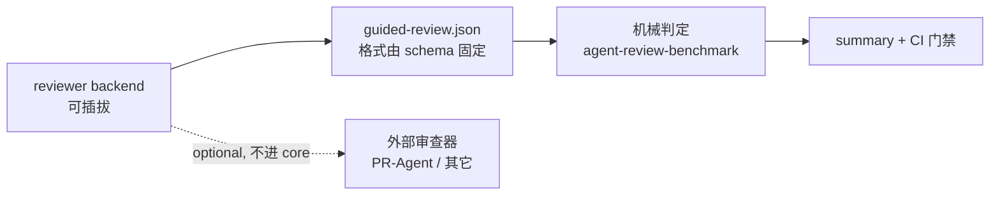

# Harness 能力成对化：审查契约、应用验证证据与 Skill 可发现性

> 状态：提案（proposed），待批准
> 日期：2026-10-22
> 审批单：Decision `D-20261022075531`（type=approval, gate=mission, action=architecture）
> 等待点：Waitpoint `WP-20261022075557`（gate=user, owner_workflow=/arch-design，已关联上述 Decision，状态 blocked）
> 关联执行计划：[`docs/exec-plans/active/harness-phase9-review-and-runtime-evidence.md`](../exec-plans/active/harness-phase9-review-and-runtime-evidence.md)
> 前置：[`docs/architecture/harness-optimization-design.md`](./harness-optimization-design.md) §支柱 2 / §P1
> 前置阶段：[`docs/exec-plans/active/harness-phase8-application-legibility.md`](../exec-plans/active/harness-phase8-application-legibility.md)（Phase 8，文档层已完成）

---

## 1. 摘要

本提案处理 cortex-agent 当前的一类**系统性缺陷**，而不是三个孤立问题：

> **对外承诺了能力，但能力的三要素不齐**——①可执行的判定 ②可发现的使用说明 ③生产端到判定端的机械通路。

三处实例：

| 实例 | 契约（判定格式） | 生产端 | 发现端 | 现状后果 |
|---|---|---|---|---|
| 异构审查 | `guided-review.schema.json`、`benchmark-summary.schema.json` 已定义 | **散文**（`/code-review` workflow 六步），无结构化产出 | 正常 | finding 只能人读，无法机械判定 |
| 应用可理解性 | `verification-summary.json` 等三件套已定义 | **空**（`init.js` 只写 `not_run` 空壳） | 正常 | `/ship` CLEAN 的阻断能力实际为空 |
| Skill 能力分发 | 脚本实现应在 L1 | 部分缺（`vcs-pr`/`maturity-tracker` 缺入口文件） | **缺**（15 个 skill 无 `SKILL.md`；L1 无 `skill-index.json`） | 下游既发现不了这些能力，也有 skill 直接跑不起来 |

**统一原则**：任何对外承诺的能力，必须同时具备可执行判定、可发现说明、以及从生产到判定的机械通路。三者缺一，能力就是幻觉。

本提案给出三个子提案，并复用 S6 已交付的 benchmark 机制（数据集 → 候选命令 → 机械断言 → 计数 → summary，强制「有区分力」），不重造轮子。

---

## 2. 当前状态（代码级核查结论）

以下均为对本仓代码与模板的实际核查结果，不是文档复述。

### 2.1 异构审查：契约在，生产端是散文

- `agent-review-benchmark` skill 定义了 `guided-review.schema.json` 与 `benchmark-summary.schema.json`，并能对**已给出的**断言计数做机械判定。
- 但 finding 的**生产**环节没有结构化定义：`.agent/workflows/code-review.md` 的六步（架构合规 / 代码规范 / 测试完整性 / 性能鲁棒性 / 文档同步）全是自然语言指令，输出形态不固定。
- S6 交付的 `scripts/agent-review-benchmark-runner.cjs` 解决了「断言是否被真实评估」的问题，但**没有解决「finding 从哪来、以什么格式来」**。

### 2.2 应用可理解性：Phase 8 完成了文档层，能力层空缺

- Phase 8 的 6 个任务（T-H18 ~ T-H23）全部标记为「已完成」，产出为 `docs/reliability/` 下的四类 legibility 入口、`verification-templates.md` 与 `runtime-evidence-integration.md`——**全部是文档层**。
- 证据生产端：`templates/_shared/.agent/skills/runtime-evidence/scripts/init.js` **只创建三个空壳 JSON**，所有字段为 `not_run` / `skipped` / `[]` / `null`。
- `runtime-evidence/SKILL.md` 自述：`browser-verification.json` 是「由 UI/E2E 验证流程（Playwright、Chrome DevTools、手动截图）完成后写入」——**cortex 定义契约，但自己不生产证据**。
- 推论：`/ship` CLEAN 读 `verification-summary.json`，`overall_status: "fail"` 才阻断；而**没有任何组件会把它变成 `fail`**，它恒为 `not_run`。S1 把 `/ship` 的散文门禁机械化时，接的是这条证据链的**下游**，生产端是空的。

### 2.3 Skill 分发：既缺说明，也有 skill 不可用

- L1 模板 `templates/_shared/.agent/skills/` 共 33 个 skill，其中 **15 个只有 `scripts/`，没有 `SKILL.md`**：`agent-visibility`、`architecture-guard`、`doc-gardening`、`graphify`、`knowledge-lint`、`mission-progress`、`runtime-continuity`、`runtime-evidence`、`runtime-state-integration`、`runtime-state-mcp`、`secrets`、`session-triage`、`sync-global`、`vcs-pr`、`weekly-report`。
- 这些 `SKILL.md` **在 L1 的 git 历史中从未存在过**（不是被删的回归），说明是长期状态。
- `.agent/skills/skill-index.json`（38 条，含 intents / triggers / cost_estimate）**只在 L3**，L1 没有。而该索引是**路由索引**（何时用），不是能力清单（是什么）。
- code-mode init / upgrade 会把 `templates/_shared/.agent` 整体铺到项目（见 `lib/setup/index.js` 注释），因此这 15 个 skill 会以「有脚本、无说明、无索引」的状态进入下游项目。

**已实证的边界结论**（2026-10-22 核查）：

- `scripts/check-l3-boundary.js` 是**基于 `scope: L3` frontmatter 标记**的检测。把这 15 个 skill 的 L3 `SKILL.md` 直接复制进 L1，**不会**触发该门禁（实测 0 违规）——因为这 15 个文件的 frontmatter 均无 `scope: L3` 标记。
- 这 15 个 `SKILL.md` **均未引用任何 L3 独有规则**（`core-principles` / `vcs-pr-flow` / `test-policy` / `agent-scope` 等 30 个 L3-only 规则无一被引用）。
- 唯一的真实耦合：`runtime-evidence/SKILL.md` 末行引用 `../../../docs/reliability/verification-templates.md`，而 **L1 模板不发布 `docs/` 目录**（`templates/_shared/` 下只有 `integrations/`）——该链接在下游必然失效。

因此 P-003 的实际风险远低于初判：**主因是「缺说明」，不是「内容越界」**；需要处理的是 1 处死链，而不是 15 份内容重写。

### 2.4 更严重的一层：L1 有 skill 完全不可用

进一步做 L1↔L3 文件集对等核查（排除 `.bak` / `.DS_Store` / `*.test.js` / 嵌套重复目录）后，发现**除缺 manifest 外，还有 5 处实现文件缺失**，其中 2 处导致 skill 在下游完全不可用：

| skill | L1 缺失 | 后果 |
|---|---|---|
| `vcs-pr` | `scripts/index.js` | **完全不可用**。该文件是 PR 编排器，承担密钥解析（经 secrets skill 取 `token_ref`）、backend 调用与 `vcs_pr_opened/merged/closed` 事件发射；L1 只有 3 个 backend 文件，无人调用它们。而 L1 的 `config/vcs.yml.example` 正在教用户配置并使用 `vcs-pr` |
| `maturity-tracker` | `scripts/index.js` | **完全不可用**，且 L1 **有** `SKILL.md`——manifest 存在却指向不存在的实现 |
| `runtime-evidence` | `scripts/generate-summary.js` | SKILL.md 声明的「核心功能」不可用（只剩初始化空壳） |
| `secrets` | `scripts/generate.js` | 密钥生成器缺失 |
| `runtime-state-integration` / `runtime-state-mcp` | `agents/openai.yaml` | agent 清单缺失 |

另有分发垃圾：`templates/_shared/.agent/skills/runtime-evidence/.DS_Store` 被随模板分发。

L3 侧也存在两处**路径事故产生的重复目录**（`secrets/secrets/scripts/*`、`vcs-pr/vcs-pr/scripts/backends/*`），不应被同步进 L1。

> 这把 P-003 的性质从「补文档」升级为「修分发完整性」：缺 manifest 是**不可发现**，缺实现是**不可用**，两者后果不同，但根因相同——L1 与 L3 之间没有对等性约束。

### 2.4 相关事实

- 仓库内唯一的真实浏览器自动化是 `motion` skill 的 puppeteer，用途是 deck 渲染，**不是验证**。
- `lib/byok/registry.js` 的 BYOK 探测只覆盖 `openai` / `seedream` / `nano_banana` 三个 provider，且均为图像/生成类，**不覆盖 LLM provider**。

---

## 3. 子提案

### P-001 异构审查者契约（可插拔 reviewer backend）

**目标**：让 finding 具备固定格式，从而可被机械判定；同时为外部审查器预留接入口，但不进 core。

**核心不变式**：

> **finding 的产出格式由 schema 固定，谁产出都行。**

判定与生产彻底分离：



**backend 形态**：

| backend | 说明 | 依赖 | 状态 |
|---|---|---|---|
| `builtin` | `/code-review` workflow + `code-reviewer` 子代理，按 `guided-review` schema 产出 | 零（已有能力） | 提议新增 |
| `external` | 任意能产出 `guided-review.json` 的审查器 | 由使用者自行提供 | 仅预留接口，不进 core |

**判定要求**：复用 S6 的区分力门禁——reference 候选必须 10000 bp，noop 候选必须 < 5000 bp。否则基准只验证了「被测对象没坏」，不能发现回归。

**明确不做**：不把任何外部 LLM 审查器设为 required check；不在 core 引入第三方依赖。

---

### P-002 应用验证证据数据集（Phase 8 可执行化）

**目标**：给 `/ship` CLEAN 一个**真实**判据，而不是恒为 `not_run` 的空壳。

**机制**：把 S6 的 benchmark 机制平移到运行行为验证。

```text
benchmarks/runtime-evidence/<app>/dataset.json
  case
    fixture    → 物化被测环境
    setup      → 启动 / 准备
    candidates → 真实启动命令 / 健康检查 / 端点探测
    assertions → 复用现有 11 种断言
```

**门禁**：reference 必须 10000 bp，noop 必须 < 5000 bp（与 S6 同构）。

**证据生产端分层**：

| 层 | 覆盖 | 生产方式 | 依赖 |
|---|---|---|---|
| **API 层** | 进程起没起、端点通不通、退出码、输出字段 | cortex 自带纯 Node stdlib 探针 | 无 |
| **UI 层** | 渲染、交互、截图、console error | cortex **只定义格式**，由宿主浏览器能力产出 | 宿主能力（跨宿主最难） |

**关键设计取舍**：cortex **不自己实现浏览器驱动**，只定义「结果怎么写成 `browser-verification.json`」——这与 harness 优化设计 §4.5「把工程品味编码成机械化规则」一致。

**边界（必须写进契约）**：API 层只覆盖**可机械断言的运行行为**，覆盖不了「按钮变没变可点」「页面白不白」这类需要渲染/交互的断言。UI 层是后续独立里程碑，不在首版承诺内。

**产物落点**：`verification-summary.json`，让 `/ship` CLEAN 的 `overall_status` 第一次具备从 `not_run` 变为 `pass`/`fail`/`partial` 的通路。

---

### P-003 L1 分发完整性（manifest + 实现 + 垃圾清理）

**目标**：让 L1 与 L3 之间的分发对等性成为**可机械校验的约束**，消除「不可发现」与「不可用」两类缺口。

**四项动作**：

1. **补齐 15 个 L1 skill 的 `SKILL.md`**。来源为 L3 `.agent/skills/<name>/SKILL.md`。已实证：这 15 个文件**既无 `scope: L3` 标记，也不引用任何 L3-only 规则**，因此同步不需要逐个重写；同步后需做的是**修正下游必然失效的引用**（当前已知 1 处：`runtime-evidence` → `docs/reliability/verification-templates.md`，而 L1 不发布 `docs/`）。同步仍需过 `scripts/check-l3-boundary.js` 作为回归保险。
2. **补齐 5 处缺失的实现文件**：`vcs-pr/scripts/index.js`、`maturity-tracker/scripts/index.js`、`runtime-evidence/scripts/generate-summary.js`、`secrets/scripts/generate.js`、`runtime-state-{integration,mcp}/agents/openai.yaml`。其中前两项让 skill 从「不可用」变为「可用」，是本子提案的**最高优先级**。
3. **清理分发垃圾**：移除 `templates/_shared/.agent/skills/runtime-evidence/.DS_Store`；同步时**排除** L3 侧的 `.bak` / `.bak.prev` / `.new` / `.DS_Store` / `*.test.js` 以及两处路径事故产生的嵌套重复目录（`secrets/secrets/scripts/*`、`vcs-pr/vcs-pr/scripts/backends/*`）。
4. **新增机械门禁**（见下），接入 CI。

**门禁设计（三条，全部只读、hermetic）**：

| 检查 | 判据 |
|---|---|
| manifest 完整性 | L1 每个 skill 目录必须有 `SKILL.md`，且 frontmatter 必填字段合规 |
| **文件集对等性** | L1 相对 L3 不得缺实现文件（按第 3 条的排除清单过滤） |
| 链接有效性 | manifest 内的文档链接必须指向 L1 实际分发的路径（`docs/` 属未分发路径） |

**为什么门禁必须包含「文件集对等性」**：只查 manifest 会漏掉 `maturity-tracker` 这类**manifest 在、实现缺**的情况——那是最难被发现的一类，因为表面看完全正常。

**发现机制选型**（待定，R6）：L1 走「manifest 发现」还是「索引发现」。当前 L3 两者都有（`skill-index.json` 38 条 + 全部 SKILL.md），L1 两者都没有。本子提案先只做 manifest（低风险、可机械校验），索引策略单独立项。

**注意**：本子提案是三件里唯一**纯分发修复**、无设计风险的部分，可独立先行。

---

## 4. 为什么不对接 PR-Agent（已评估的替代方案）

评估结论：**不把 PR-Agent 作为 core 依赖或 required check**。四条论据：

1. **分发污染**。cortex 的硬约束是「零依赖原则」+「纯 Node stdlib」（`architecture-design.md` §核心设计哲学 1）。集成 PR-Agent = 每个下游项目都要装 Python + LiteLLM + 配 LLM key。这与 L1 模板「新增功能优先体现为模板文件变更」的分发模型冲突。
2. **输出格式不匹配**。PR-Agent 产出 markdown comment，不是 `guided-review.json`。适配需要一层 LLM/正则抽取器，比让 cortex 自己的 reviewer 直接按 schema 产出更脆、更贵、多一个失败点。
3. **自研成本显著更低**。自研 = schema + 一个 workflow + reviewer prompt + CI 接线，约 1–2 个 PR。集成 = Python 依赖链 + 两个 toml + 5 个已知坑（`custom_model_max_tokens` 必填、`max_model_tokens` 默认 32000 会静默裁 diff、reasoning 模型吃光 token、`.secrets.toml` 泄漏风险、上游 main 分支漂移）+ 分发污染。
4. **能力上无增量**。PR-Agent 的核心是「LLM 判断 + diff 解析 + GitHub 集成」：判断能力 cortex 已有（`/code-review`、`code-reviewer` 子代理、多模型 provider）；diff 解析 cortex 不缺；GitHub 集成对本仓价值低（单账号仓库、`reviews=null`、无人类消费 inline comment）。

**但保留接入口**：P-001 的 backend 接口让「将来接 PR-Agent」变成写一个 adapter，而不是改 core。届时该 adapter 不进 core、不污染分发。

**成本参考（仅供后续决策）**：PR-Agent 本体 MIT 许可、$0；成本仅为 LLM token，按官方口径约 $0.02–$0.05 / 小 PR。Actions 侧本仓为 public repo，分钟不计入配额。

---

## 5. 方案对比

| 维度 | 现状（Status Quo） | 本提案 | 评估 |
|---|---|---|---|
| 架构合规性 | 契约与生产端分离，能力承诺无通路；不违反现有规则但违背 harness 优化设计 §支柱 2/§支柱 3 的意图 | 判定 / 生产 / 发现三层齐备，每层都有机械门禁 | 提升；符合「机械化约束优先于 Prompt 叙述」 |
| 可扩展性与维护成本 | 每新增一类验证都要手写散文并人工判断 | 新增验证 = 新增一个数据集 case；新审查器 = 新增一个 backend | 提升；边际成本从「写流程」降为「写数据」 |
| 运行时性能与系统复杂度 | 无新增运行时开销（因为能力是空的） | API 层探针每次 ~百毫秒级；UI 层依赖宿主能力 | 可接受；UI 层成本待实测后再定阈值 |
| 实施难度与迁移成本 | — | P-003 低（纯分发修复）；P-002 API 层中（复用 S6 机制）；P-002 UI 层高（跨宿主）；P-001 中（需定 schema） | 分层递进，无一次性大爆炸 |
| 分发影响 | L1 存在 15 个无 manifest 的 skill | 补齐后 L1 体积增加，且新增 CI 门禁约束后续改动 | 需要量化 L1 体积增量后再定 |

---

## 6. 风险

| ID | 风险 | 影响 | 缓解 |
|---|---|---|---|
| R1 | 数据集沦为「给实现写的同义反复测试」 | 门禁看似通过，实则无发现力 | 强制复用历史真实缺陷；强制 noop 区分力（< 5000 bp）；每条断言必须被真实评估 |
| R2 | P-002 API 层无法覆盖 UI/交互断言 | 用户误以为 P1 已完成 | 在 schema 与 SKILL.md 中显式声明覆盖边界；UI 层单列里程碑 |
| R3 | 补 15 个 manifest + 5 个实现文件扩大 L1 分发体积 | 下游安装变重 | 先量化体积增量；若显著，改为「索引发现 + 精简 manifest」双轨 |
| R4 | 下游死链：L1 的 `SKILL.md` 引用本仓 `docs/` 路径（L1 不发布 `docs/`） | 下游 agent 点了链接得到 404 | 已实证当前至少 1 处（`runtime-evidence`）；manifest 门禁需包含链接有效性检查 |
| R5 | 同步引入 L3 垃圾（`.bak` / `.DS_Store` / 路径事故产生的嵌套重复目录） | L1 带上无用文件，体积与噪音上升 | 同步时按排除清单过滤；L3 侧垃圾另行清理 |
| R6 | 与 S6 已交付机制重复造轮子 | 维护两份相似 harness | 提案明确**复用** `agent-review-benchmark-runner.cjs` 与 11 种断言，只新增数据集格式 |
| R7 | 发现机制选型未定（manifest vs 索引） | P-003 的发现策略无法定稿 | P-003 拆两步：先补 manifest（低风险），索引策略单独立项 |

---

## 7. 里程碑

| 里程碑 | 内容 | 依赖 | 风险 |
|---|---|---|---|
| **M1** | P-003：补齐 15 个 L1 `SKILL.md` + manifest 完整性 CI 门禁 | 无 | 低 |
| **M2** | P-002 API 层：runtime-evidence 数据集格式 + 第一个真实数据集 + 接入 `verification-summary.json` | M1 | 中 |
| **M3** | P-001：`guided-review` finding schema + builtin backend + 纳入 benchmark 判定 | M2（复用同一 harness 契约） | 中 |
| **M4** | P-002 UI 层：宿主浏览器能力对接 | M2 + 宿主能力 | 高，暂不排期 |

---

## 8. 验收标准

**M1**
- `templates/_shared/.agent/skills/*/SKILL.md` 覆盖全部 33 个 skill
- 5 处缺失实现文件补齐，`vcs-pr` 与 `maturity-tracker` 在下游**从不可用变为可用**
- L1 内无 `.DS_Store` / `.bak` / 嵌套重复目录等分发垃圾
- 新增 L1 分发完整性检查脚本并接入 CI，三条检查（manifest 完整性 / 文件集对等性 / 链接有效性）全部覆盖；反向验证：人为删除一个 `SKILL.md`、人为删除一个实现文件、写入一条 `docs/` 死链，都必须让检查失败
- `pnpm check:l3` 零违规

**M2**
- 存在至少一个 `benchmarks/runtime-evidence/<app>/dataset.json`，其 reference 候选 10000 bp、noop 候选 < 5000 bp
- 一次真实运行后 `.agent/metrics/verification-summary.json` 的 `overall_status` 能从 `not_run` 变为 `pass` / `fail`
- `/ship` CLEAN 在 `overall_status: "fail"` 时阻断，在 `not_run` 时给出明确告警而非静默通过

**M3**
- `guided-review` finding schema 发布，且 summary 仍符合已发布 schema
- 至少一个 builtin backend 能产出合规 finding
- 判定具备区分力：noop finding 集的得分显著低于 reference

**全量**
- CI `full-test` 保持全绿且零 NON-HERMETIC 漂移
- 不引入任何新的 npm 依赖，`bin/cli.js` 仍只用 Node 内置模块

---

## 9. 不做的事

- 不把任何外部 LLM 审查器设为 required check
- 不在 core 引入 Python 或任何非 Node 运行时依赖
- 不重写 `agent-review-benchmark` 已交付的 harness 与断言集
- 不在本提案内实现 UI 层浏览器驱动
- 不改 `agent-review-benchmark` skill 的「默认不用外部 LLM judge」契约

---

## 10. 下一步

1. 提交本提案走审批（Decision + Waitpoint，见 `.agent/workflows/arch-design.md` §Communication Runtime Integration）
2. 批准后按 M1 → M2 → M3 推进，每项独立 PR，PR 内验证 + CI 绿 + 合并
3. M4 待宿主浏览器能力成熟后单独立项
